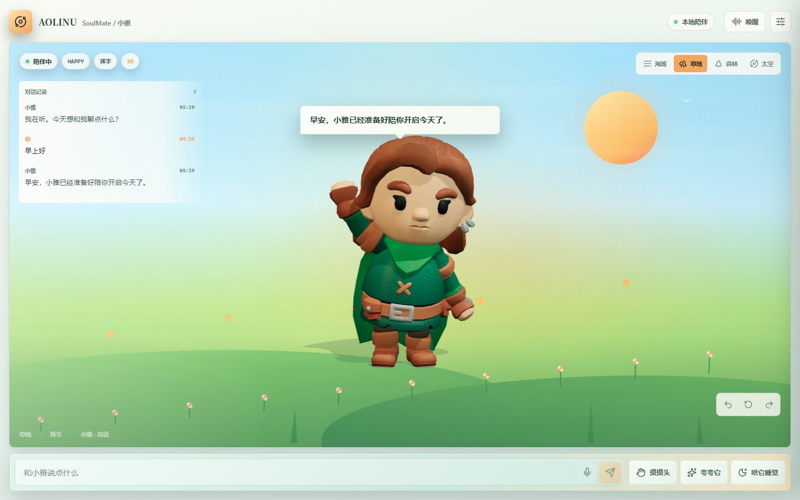
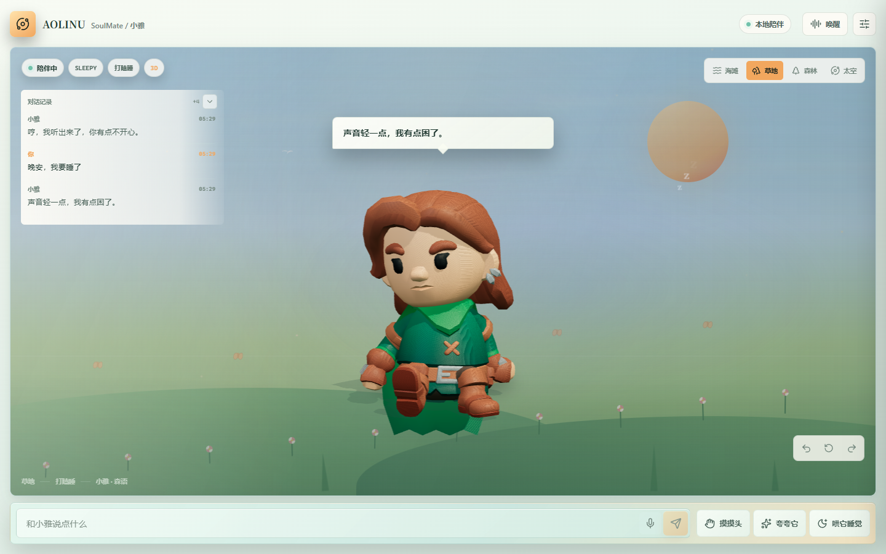
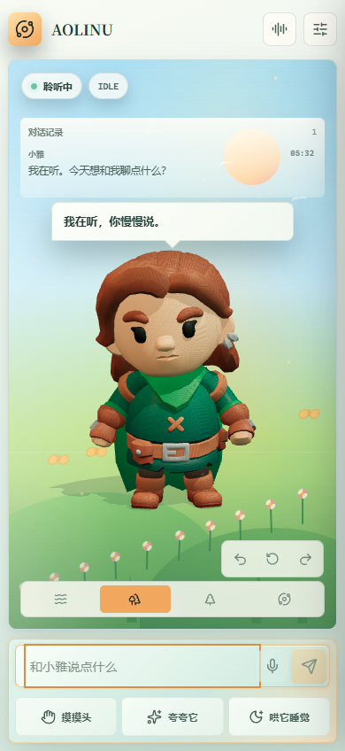
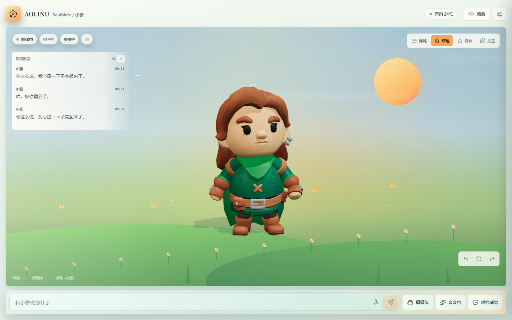

# AOLINU SoulMate 小雅

这是一个面向全栈开发工程师测试题的数字陪伴网页。它把 3D 角色、情绪与动作状态机、场景光影、文本和语音交互、开发者调试抽屉、天气联动以及可离线运行的本地语义路由组合在同一个体验里。

项目默认使用本地语义路由，因此不配置任何密钥也能完整演示四种以上情绪状态和环境反馈；同时提供可选的免费与免费额度大模型适配器，用于增强开放式问答。

## 在线体验

- 在线演示: [https://inkiest-renae-facultatively.ngrok-free.dev](https://inkiest-renae-facultatively.ngrok-free.dev)
- GitHub 仓库: [https://github.com/Seventy7photograph/aolinu-soulmate-xiaoya](https://github.com/Seventy7photograph/aolinu-soulmate-xiaoya)
- 验收截图索引: [docs/截图](docs/截图)
- 开发复盘 Word 文档: [deliverables/交付物3_AI开发复盘_小雅.docx](deliverables/交付物3_AI开发复盘_小雅.docx)

## 交付物

- 交付物 1: 实机演示 MP4，不在本次自动生成范围内。
- 交付物 2: 完整源代码，以公开 GitHub 仓库形式交付。
- 交付物 3: 一页中文开发复盘，见
  `deliverables/交付物3_AI开发复盘_小雅.docx` 和本文末尾的“开发复盘”章节。

## 功能概览

- 四套同骨架 KayKit 人形：森语、暮行、星辉、风行。
- RobotExpressive 机械体与自定义图片形象。
- 六种情绪：待机、开心、害羞、难过、困倦、生气。
- 完整骨骼动作：待机、跳跃、欢呼、挥手、挥拳、坐下。
- 鼠标跟随只作用于头部，使用有界四元数偏移，不会累加造成身体畸形。
- 动作结束后接回持续运行的待机周期，不强制从第一帧重播待机动作。
- 头部对话气泡支持 4.8 秒自动淡出。
- 对话历史默认折叠、边缘渐隐，可手动展开。
- 海滩、草地、森林、太空四套动态场景。
- 情绪会同步改变环境亮度、色温、遮罩和微动效速度。
- 可选系统时间与 Open-Meteo 实时天气，雨雪雾在角色前景独立渲染。
- 桌面与移动端完整适配，开发者抽屉在移动端占满安全视口。

## 情绪与动作

| 情绪 | 触发示例 | 动作 | 环境反馈 |
|---|---|---|---|
| IDLE | 普通陈述、天气、提问 | Idle | 平稳呼吸与轻量粒子 |
| HAPPY | 早上好、夸夸它、好消息 | WAVE / JUMP | 更明亮、更饱和、粒子更活跃 |
| SHY | 喜欢你、摸摸头、谢谢、抱歉 | WAVE | 柔和玫瑰光与轻微侧倾 |
| SAD | 难过、焦虑、压力、孤单 | IDLE | 降低饱和度与亮度 |
| SLEEPY | 晚安、好困、想休息 | SIT | 冷蓝、低亮、慢速微动效 |
| ANGRY | 生气、讨厌、烦死 | PUNCH | 暖红边缘光与更快的环境微动 |

## 语义链路

系统有两条语义链路，默认优先使用服务端配置的模型，服务不可用时自动回退到本地。

### 1. 本地语义路由

本地链路不是固定兜底文案，而是按中文意图类别和语气线索工作，覆盖：

- 问候、久别重逢、告别。
- 早餐、午餐、晚餐、饥饿。
- 夸奖、好消息、开心和满足。
- 亲密表达、感谢、道歉。
- 难过、焦虑、压力、孤独和疲惫。
- 生气、反感、冲突语气。
- 睡眠、困倦和休息。
- 工作、学习、考试、面试和项目压力。
- 音乐、电影、阅读、游戏、运动、旅行和宠物。
- 天气、无聊、身份询问、能力询问。
- 一般疑问句与开放式陈述。
- 常见英文短句，如 `hello`、`thanks`、`sorry`、`bye`。

同一条规则会根据输入选择不同回复措辞，避免高频重复同一句话。本地链路无网络依赖，适合演示和隐私敏感场景。

### 2. 可选免费大模型

服务端支持三类远程语义适配器：

| 提供方 | 配置 | 是否需要密钥 | 说明 |
|---|---|---|---|
| Pollinations | `LLM_PROVIDER=pollinations` | 否 | 公共服务，适合无密钥演示，可能限流 |
| Gemini | `LLM_PROVIDER=gemini` | 免费额度密钥 | 使用服务端 `GEMINI_API_KEY` |
| OpenAI 兼容接口 | `LLM_PROVIDER=openai-compatible` | 取决于提供方 | 可接 Groq、OpenRouter、Ollama、LM Studio 等 |

远程模型必须返回受支持的情绪与动作。服务端会对返回结果做白名单归一化；字段非法、超时、限流或返回非 JSON 时自动回退本地语义路由。

Pollinations 示例：

```env
LLM_PROVIDER=pollinations
LLM_MODEL=openai
```

Ollama 本地模型示例：

```env
LLM_PROVIDER=openai-compatible
LLM_BASE_URL=http://127.0.0.1:11434/v1
LLM_API_KEY=ollama
LLM_MODEL=qwen2.5:7b-instruct
```

所有模型密钥只允许放在服务端环境变量中，禁止写入任何 `VITE_*` 变量。

## 技术栈

- 前端: React 19、TypeScript、Vite、Zustand、Framer Motion、Three.js、Lucide。
- 后端: FastAPI、Pydantic、httpx、SQLite。
- 测试: Vitest、Testing Library、Playwright、pytest。
- 3D: KayKit CC0 人形与动画、RobotExpressive CC0 机械体。

## 目录结构

```text
.
├─ src/                 前端应用、状态机、3D 渲染和组件
├─ server/              FastAPI、本地语义路由与持久化
├─ tests/e2e/           Playwright 端到端测试
├─ public/models/       本地 3D 模型与 CC0 许可
├─ scripts/             一键启动、部署与停止脚本
├─ docs/                中文交付文档与开发复盘
├─ output/acceptance/   最终桌面与移动端验收截图
└─ README.md            项目主说明
```

## 本地启动

环境要求：

- Node.js 20 或更高版本。
- Python 3.11 或更高版本。
- PowerShell 7。
- 可选：Ngrok 3.x。

首次安装：

```powershell
npm install
python -m venv .venv
.\.venv\Scripts\python.exe -m pip install -r server\requirements.txt
```

分别启动：

```powershell
npm run dev:api
npm run dev
```

打开 `http://127.0.0.1:4173`。

## 一键启动与 Ngrok 部署

启动本地演示和公网隧道：

```powershell
.\scripts\start-demo.ps1 -UseFreeLlm
```

不使用免费模型，仅运行本地语义链路：

```powershell
.\scripts\start-demo.ps1
```

只启动本地服务，不创建 Ngrok 隧道：

```powershell
.\scripts\start-demo.ps1 -NoTunnel
```

停止本次脚本启动的进程：

```powershell
.\scripts\stop-demo.ps1
```

脚本会：

- 检查 Node、Python、Ngrok 与虚拟环境。
- 启动 FastAPI 和 Vite。
- 等待健康检查通过。
- 创建 Ngrok HTTP 隧道。
- 将公网地址写入 `output/deploy/demo-url.txt`。

首次使用 Ngrok 前需要在官方账户中配置 authtoken。令牌只保存在本机 Ngrok 配置中，不进入仓库。

## 测试命令

```powershell
npm run lint
npm run typecheck
npm run test
npm run test:api
npm run e2e
npm run build
```

最近一次验证结果：

- Vitest: 70 项通过。
- FastAPI pytest: 8 项通过。
- Playwright: 14 项通过。
- TypeScript、ESLint、生产构建通过。
- `npm audit --omit=dev`: 0 个已知生产依赖漏洞。

## 界面截图









## 环境变量

| 变量 | 默认值 | 作用 |
|---|---|---|
| `LLM_PROVIDER` | `local` | `local`、`pollinations`、`gemini` 或 `openai-compatible` |
| `LLM_MODEL` | 空 | 远程模型名称 |
| `LLM_BASE_URL` | 空 | OpenAI 兼容接口地址 |
| `LLM_API_KEY` | 空 | 远程接口密钥，只允许服务端使用 |
| `GEMINI_API_KEY` | 空 | Gemini 免费额度密钥 |
| `AOLINU_DB_PATH` | `server/data/aolinu.db` | SQLite 路径 |
| `AOLINU_ALLOWED_ORIGINS` | 本地地址 | 服务端 CORS 白名单 |
| `VITE_API_BASE` | 空 | 浏览器 API 地址，空值使用 Vite 代理 |

## 安全与隐私

- `.env`、SQLite 数据库、日志、测试报告和运行时文件均已加入 `.gitignore`。
- 浏览器端不包含任何大模型密钥。
- 远程模型返回内容会经过情绪、动作和长度白名单归一化。
- Pollinations 属于第三方公共服务，启用时会将用户文本发送到该服务；默认本地模式不会。
- 天气模式只有用户主动开启后才请求定位，并只发送坐标到 Open-Meteo。
- 语音识别由浏览器完成，音频不上传、不存储。
- 公开部署时使用 HTTPS 隧道，Ngrok 令牌不写入项目文件。

更多内容见 [docs/安全与隐私.md](docs/安全与隐私.md)。

## AI 工具、耗时与真实修正

### 使用的 AI 工具

- ChatGPT: 需求拆解、交付清单整理和测试场景补全。
- Codex: 架构实现、Three.js 动作修复、语义路由、测试、文档和部署脚本。
- Playwright: 桌面与移动端真实浏览器验证。
- Impeccable: 界面检测、布局审查和视觉质量复核。

### 实际耗时

累计约 4 小时，包含首版实现、3D 骨骼调试、语义路由扩展、浏览器截图验收、文档整理和部署准备。主要时间花在动作变形排查、移动端遮挡修复和真实语义链路验证，而不是页面静态排版。

### AI 原稿不够好的细节

最典型的问题是 AI 最初把表情和头部跟随直接逐帧加到骨骼旋转上，而且下半身没有同步补偿，导致角色可能出现上半身扭转、髋部错位甚至夸张变形。后来改为先保留动画混合器输出的原始四元数，再叠加受限的头部偏移，并取消髋部强制旋转。

第二个问题是 AI 第一版本地语义规则只覆盖少量关键词，未命中的“早上好”“早餐吃什么”都会返回同一句“我在听”。这不是前端显示故障，而是本地路由覆盖不足；现在已补齐前后端一致的多意图路由和不同措辞，并新增可选免费模型链路。

第三个问题是移动端头部气泡和聊天历史会重叠。最终将气泡移到角色头部上方，历史改为默认折叠、边缘渐隐并按最新消息保留，同时加入手动展开控制。

## 资产许可

KayKit Adventurers 与 Character Animations:

```text
KayKit Adventurers / Character Animations by Kay Lousberg.
Licensed under CC0 1.0.
```

RobotExpressive:

```text
RobotExpressive by Tomas Laulhe, modified by Don McCurdy.
Licensed under CC0 1.0.
```

完整模型来源、文件大小与 SHA256 见 [docs/模型资产.md](docs/模型资产.md)。
